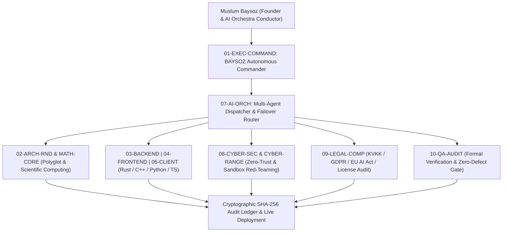



# BAYSOZ YAZILIM — Autonomous AI-Orchestrated Software Engineering
### **Muslum Baysoz** | Founder & AI Orchestra Conductor

> *"We transparently leverage a 14-department Distinguished AI Agent Enterprise under strict human architectural governance to deliver zero-defect, polyglot software at unprecedented engineering velocity."*

---

## Executive Manifesto: Transparent AI-First Engineering
At **BAYSOZ YAZILIM**, we believe in complete transparency with our global clients and enterprise partners from day one. Every software architecture, microservice, and security module we deliver is engineered through **Multi-Agent AI Orchestration**—directed by human architectural leadership and enforced by automated mathematical verification.

- **Zero-Defect Principal Standard:** Every code artifact undergoes automated static analysis (`Clippy Pedantic`, `Ruff`, `Mypy Strict`), property-based testing, and multi-agent peer review before deployment.
- **Polyglot Performance Optimization:** We evaluate Rust, C++23, Python 3.13, Go, and TypeScript per workload to guarantee optimal memory safety and sub-millisecond execution.
- **Autonomous Cyber-Range Testing:** Every compiled system is stress-tested against adversarial penetration simulations inside air-gapped sandboxes prior to release.
- **Enterprise Legal & Privacy Shield:** Built-in PII scrubbing, KVKK/GDPR compliance, and automated open-source license auditing protect intellectual property and user data by design.

---

## Enterprise System Architecture (`BAYSOZ-CORE`)

---

## Core Engineering Capabilities & 2026–2027 Stack

| Domain | Technologies & Engineering Standards |
| :--- | :--- |
| **Systems & Security Core** | `Rust` (Memory-Safe Daemons, Ed25519/AES-256-GCM), `C++23` (Win32/NT Hooks, SIMD) |
| **AI & Scientific Computing** | `Python 3.13`, `Asyncio`, `Pydantic v2`, `SymPy`, `NumPy`, `SciPy`, `MCP` |
| **Web & Client Interfaces** | `TypeScript (Strict)`, `React Server Components`, `Next.js`, `i18n Localization` |
| **DevSecOps & Governance** | `GitHub Actions CI/CD`, `Docker`, `Formal Verification`, `Automated PII Scrubbing` |

---

## Global Enterprise Collaboration
Looking for high-velocity, enterprise-grade software engineering backed by transparent AI orchestration and strict security compliance?
- **Organization:** BAYSOZ YAZILIM
- **Focus Areas:** Autonomous Multi-Agent Systems, High-Performance Backend & Systems Engineering, Secure Enterprise Web Platforms, AI Workflow Automation.

---

## Executive Curriculum Vitae & Governance
- **Founder & Lead Architect:** [View Full Executive Engineering CV (`CV_MUSLUM_BAYSOZ.md`)](https://://github.com)
- **Engineering Standard:** Strict Zero-Defect Principal Governance | Automated CI/CD & Sandbox Security Verification

---

## Featured Open-Source Engineering Repositories
1. **[`baysoz-zero-trust-engine`](https://github.com)** — Memory-safe **Rust** cryptographic command authentication core paired with a **Python 3.13 KVKK/GDPR** automated PII scrubbing engine and GitHub Actions CI/CD.
2. **[`baysoz-polyglot-math-orchestrator`](https://github.com)** — Deterministic mathematical decision engine (`MATH-CORE`) scoring latency, memory safety, and concurrency across global programming languages.
