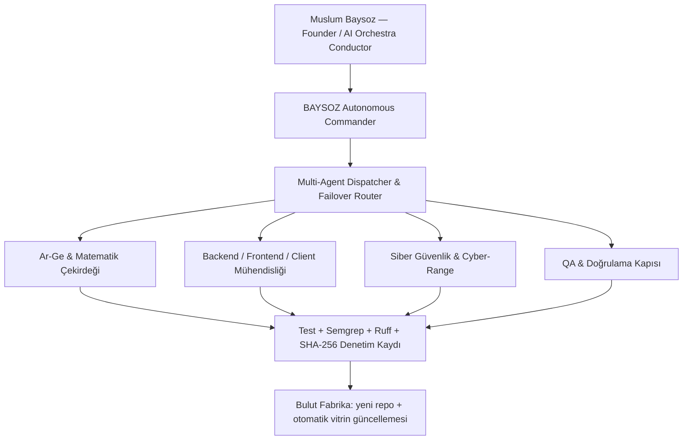

<div align="center">

# BAYSOZ YAZILIM

### Autonomous AI-Orchestrated Software Engineering

**Muslum Baysoz** — Founder & Chief AI Orchestra Conductor

[](https://github.com/yazilimbaysoz-svg/yazilimbaysoz-svg)
[](https://github.com/yazilimbaysoz-svg/yazilimbaysoz-svg/actions/workflows/bulut-fabrika.yml)
[](https://www.python.org/)
[](https://www.rust-lang.org/)
[](https://semgrep.dev/)
[](https://opensource.org/license/mit)

> Şeffaf çok ajanlı AI orkestrasyonu, insan mimari denetimi ve otomatik güvenlik doğrulamasıyla
> sıfır hata hedefli, çok dilli yazılım mühendisliği.

</div>

---

## Manifesto

**BAYSOZ YAZILIM**'da her ürün; mimari liderlik yönetiminde çalışan uzman AI ajanları,
deterministik testler ve güvenlik kapılarıyla üretilir. Süreç gizli değildir: kod, test,
workflow ve denetim kayıtları bu organizasyonda açıkça görülebilir.

- **Sıfır hata standardı:** `ruff`, `mypy`, `pytest`, `clippy pedantic` ve property-based testler.
- **Güvenlik varsayılan:** Secret taraması, OWASP kontrolleri, `semgrep` ve KVKK/GDPR uyumlu veri işleme.
- **Çok dilli optimizasyon:** İş yüküne göre Rust, C++23, Python, Go ve TypeScript seçimi.
- **Otonom teslimat:** Laptop kapalıyken bile GitHub Actions üzerinde çalışan bulut fabrikası.

## Mimari



## Yetkinlikler

| Alan | Yığın ve Standart |
| :--- | :--- |
| Sistem & Güvenlik | `Rust` (bellek güvenli daemon'lar, Ed25519 / AES-256-GCM), `C++23`, zero-trust |
| AI & Bilimsel Hesaplama | `Python 3.12`, `asyncio`, `Pydantic v2`, `SymPy`, `NumPy`, `SciPy`, MCP |
| Web & İstemci | `TypeScript (strict)`, React / Next.js, erişilebilir ve yerelleştirilmiş arayüzler |
| DevSecOps | GitHub Actions, `uv`, `ruff`, `semgrep`, `pytest`, otomatik yayınlama |

---

## Vitrin: Açık Kaynak Projeler

| Proje | Açıklama |
| :--- | :--- |
| [**sec-audit-cli**](https://github.com/yazilimbaysoz-svg/sec-audit-cli) | **Vitrin projesi.** Tek komutla gizli anahtar, zafiyetli paket ve OWASP riski tarayan; sıfır çalışma zamanı bağımlılığıyla çalışan Python CLI. Renkli terminal raporu, deterministik JSON çıktısı, maskelenmiş bulgular ve CI eşikleri sunar. |
| [**envlens**](https://github.com/yazilimbaysoz-svg/envlens) | Ortam değişkenlerine x-ray. Kod, `.env`, Docker Compose, Dockerfile ve GitHub Actions'ı çapraz tarayıp eksik key, sızdırılmış sır, config drift ve kullanılmayan template değerlerini deploy öncesi yakalar. 10+ dil, JSON/Markdown rapor, CI eşikleri ve sıfır runtime bağımlılığı. |
| [**redos-lint**](https://github.com/yazilimbaysoz-svg/redos-lint) | **Yeni vitrin projesi.** Regex kalıplarında ReDoS (catastrophic backtracking) riskini pattern'i çalıştırmadan tespit eden, sıfır runtime bağımlılıklı Python CLI. Python/JS/TS kaynak tarama, `file:line` bazlı CRITICAL/HIGH/MEDIUM bulgular, JSON/Markdown rapor ve `--fail-on` CI kapısı. |
| [**baysoz-zero-trust-engine**](https://github.com/yazilimbaysoz-svg/baysoz-zero-trust-engine) | Rust kriptografik komut kalkanı ve Python tabanlı KVKK/GDPR uyumlu PII temizleme motoru. |
| [**baysoz-polyglot-math-orchestrator**](https://github.com/yazilimbaysoz-svg/baysoz-polyglot-math-orchestrator) | Gecikme, bellek güvenliği ve eşzamanlılığa göre dil seçimi yapan deterministik matematik motoru. |
| [**Lavox-Elektronik-Kurumsal-ERP**](https://github.com/yazilimbaysoz-svg/Lavox-Elektronik-Kurumsal-ERP) | Kurumsal ERP alanında üretilen iş uygulaması. |

### sec-audit-cli — hızlı bakış

```bash
git clone https://github.com/yazilimbaysoz-svg/sec-audit-cli.git
cd sec-audit-cli
uv venv && uv pip install -e .
sec-audit . --fail-on high
```

Gizli anahtar taraması (Shannon entropisi dahil), 9 ekosistem için bağımlılık/CVE kontrolü,
OWASP denetimi ve `--online` ile isteğe bağlı OSV sorgusu tek bir araçta birleşir.

### envlens — hızlı bakış

```bash
uv tool install envlens
envlens scan . --fail-on high
envlens scan . --format markdown >> "$GITHUB_STEP_SUMMARY"
```

`MISSING`, `UNDECLARED`, `STALE`, `LEAK` ve `DRIFT` kuralları; 10+ dil, GitHub Actions
`${{ secrets.X }}` referansları ve deterministik table/JSON/Markdown raporları.

### redos-lint — hızlı bakış

```bash
uv tool install redos-lint
redos-lint check '^(a+)+$'
redos-lint scan . --fail-on high
```

Regex'i çalıştırmadan AST üzerinde çalışır: iç içe tekrar, örtüşen alternasyon, yan yana
quantifier ve backreference risklerini saniyeler içinde raporlar. Telemetri yok, ağ yok,
Python 3.11+ ve tek bağımlılık bile yok.

---

## Bulut Fabrika

[`.github/workflows/bulut-fabrika.yml`](.github/workflows/bulut-fabrika.yml) bu repoda tanımlıdır ve
**yalnızca GitHub sunucularında** çalışır; yerel laptop'un açık olması gerekmez.

- **Zamanlama:** Her gün `07:00 UTC` (10:00 TR) ve `19:00 UTC` (22:00 TR) + manuel `workflow_dispatch`.
- **Araç zinciri:** Ubuntu runner, Python 3.12, `uv`, `ruff`, `semgrep`, `opencode CLI`, `gh`.
- **Üretim:** `opencode run`, mevcut repolardan farklı yeni bir açık kaynak projesi oluşturur,
  test/lint/güvenlik kontrollerini geçirir, `gh repo create` ile yayınlar ve vitrin dosyasına sonuç yazar.
- **Vitrin güncellemesi:** Workflow yeni projeyi aşağıdaki tabloya ekleyip commit/push eder.

### Gerekli repository secrets

| Secret | Amaç |
| :--- | :--- |
| `GH_TOKEN` | Yeni repo oluşturma ve bu repoya push yetkisi olan classic PAT (`repo` scope). `GITHUB_TOKEN` yalnızca bu repo ile sınırlıdır; yeni repo oluşturmak için PAT gerekir. |
| `OPENROUTER_API_KEY` veya `ANTHROPIC_API_KEY` / `OPENAI_API_KEY` | `opencode run` için bulut modeli kimlik bilgisi. Yerel/ollama kullanılmaz. |

İsteğe bağlı repository variable: `OPENCODE_MODEL` (varsayılan: `openrouter/anthropic/claude-sonnet-5.5`).

<!-- FACTORY:START -->
| Otomatik üretilen proje | Açıklama |
| :--- | :--- |
| [baysoz-logmask](https://github.com/yazilimbaysoz-svg/baysoz-logmask) | Log'lardaki PII ve sırları doğrulanmış desenlerle maskeleyen bağımlılıksız CLI. Stack: `Python 3.12, uv, pytest, ruff, semgrep`. |
| [envpair](https://github.com/yazilimbaysoz-svg/envpair) | .env dosyaları arasındaki yapılandırma farklarını, eksik anahtarları ve hataları denetleyen hafif bir Python CLI aracı. Stack: `Python 3.12, uv, pytest, ruff`. |
| [baysoz-cardinalis](https://github.com/yazilimbaysoz-svg/baysoz-cardinalis) | Cardinality risk gate for OpenTelemetry and Prometheus telemetry with HLL++ estimation, unbounded-label detection, collector audits, and SARIF CI reports. | Stack: `Python, PyYAML, uv` |
| [baysoz-otelgate](https://github.com/yazilimbaysoz-svg/baysoz-otelgate) | Static policy gate and semantic linter for OpenTelemetry Collector configs with security checks and SARIF output. | Stack: `Python, PyYAML` |
| [baysoz-routegate](https://github.com/yazilimbaysoz-svg/baysoz-routegate) | Offline Kubernetes Gateway API route-conflict and shadowing gate with deterministic precedence resolution and SARIF CI enforcement — Baysöz Labs <baysozlabs@proton.me> | Stack: `Python, PyYAML, uv` |
| [baysoz-desyncforge](https://github.com/yazilimbaysoz-svg/baysoz-desyncforge) | Deterministic HTTP/1.1 request-smuggling differential-parser oracle and SARIF CI gate by Baysöz Labs <baysozlabs@proton.me> | Stack: `Python, Click` |
| [baysoz-queryoracle](https://github.com/yazilimbaysoz-svg/baysoz-queryoracle) | Deterministic offline PromQL conformance oracle with fixture evaluation, backend portability profiles, cost linting and SARIF CI gates, by Baysöz Labs <baysozlabs@proton.me>. | Stack: `Python, stdlib, PromQL, SARIF 2.1.0` |
| [baysoz-mcpcontract](https://github.com/yazilimbaysoz-svg/baysoz-mcpcontract) | Deterministic offline MCP tool-contract conformance, portability and drift gate with SARIF CI enforcement by Baysöz Labs <baysozlabs@proton.me> | Stack: `Python, stdlib` |
| [baysoz-gqlcostgate](https://github.com/yazilimbaysoz-svg/baysoz-gqlcostgate) | Offline GraphQL cost, depth, batching and authorization oracle with deterministic SARIF CI gates and a bounded adversarial probe forge by Baysöz Labs <baysozlabs@proton.me> | Stack: `Python, graphql-core, uv` |
| [baysoz-ssrfcanon](https://github.com/yazilimbaysoz-svg/baysoz-ssrfcanon) | Offline SSRF guard differential oracle for URL/IP canonicalization across parser profiles, with an adversarial bypass corpus and deterministic SARIF CI gates | Stack: `Python, pytest, hatchling` |
| [baysoz-archivebound](https://github.com/yazilimbaysoz-svg/baysoz-archivebound) | Offline archive-extraction confinement oracle with differential symlink re-rooting, hardlink and canonicalization checks and SARIF CI gates — Baysöz Labs <baysozlabs@proton.me> | Stack: `Python, zipfile, tarfile, uv, pytest, ruff, semgrep` |
<!-- FACTORY:END -->

---

## İletişim

- **Organizasyon:** BAYSOZ YAZILIM
- **GitHub:** [yazilimbaysoz-svg](https://github.com/yazilimbaysoz-svg)
- **Odak:** Otonom çok ajanlı sistemler, yüksek performanslı backend/sistem yazılımı, güvenli kurumsal web platformları.
